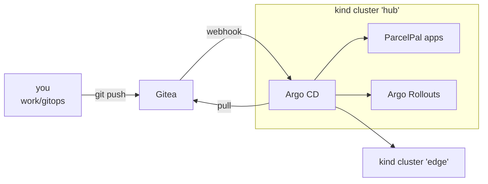

# GitOps with Argo CD – Hands-on Labs

Twelve labs that take **ParcelPal**, a parcel-delivery startup, from "`kubectl apply` from somebody's laptop" to a fully Git-driven platform: Argo CD 3.5, Helm and Kustomize, projects and RBAC, sealed secrets, sync waves and hooks, app of apps, ApplicationSets, multi-cluster, notifications, Image Updater and progressive delivery with Argo Rollouts.

Everything runs on **one Linux VM** – Kubernetes in Docker (kind), your own Git server (Gitea), no cloud account needed.



## Labs

| # | Lab | You will… | Time |
|---|---|---|---|
| 01 | [Install Argo CD](labs/LAB01-install-argocd/README.md) | build the environment, install Argo CD with Helm, use the UI and CLI | 40 min |
| 02 | [First application](labs/LAB02-first-application/README.md) | create apps from the UI, the CLI and YAML; diff, history, rollback | 40 min |
| 03 | [The GitOps loop](labs/LAB03-gitops-loop/README.md) | automated sync, webhook, self-heal, prune, tracking strategies | 45 min |
| 04 | [Helm & Kustomize](labs/LAB04-helm-kustomize/README.md) | overlays per environment, Helm charts, multiple sources | 45 min |
| 05 | [Projects & RBAC](labs/LAB05-projects-rbac/README.md) | AppProject guard rails, local users, policies, CI tokens | 40 min |
| 06 | [Private repos & secrets](labs/LAB06-private-repos-secrets/README.md) | repository credentials (HTTPS/SSH), Sealed Secrets | 45 min |
| 07 | [Sync waves & hooks](labs/LAB07-sync-waves-hooks/README.md) | waves, PreSync/PostSync hooks, sync options, ignoreDifferences | 45 min |
| 08 | [App of apps & ApplicationSet](labs/LAB08-app-of-apps-applicationset/README.md) | bootstrap everything from Git, generate apps per environment | 45 min |
| 09 | [Multi-cluster](labs/LAB09-multi-cluster/README.md) | register a second cluster, deploy to the fleet with one ApplicationSet | 35 min |
| 10 | [Notifications & Image Updater](labs/LAB10-notifications-image-updater/README.md) | webhook notifications, automatic image bumps with git write-back | 45 min |
| 11 | [Progressive delivery](labs/LAB11-progressive-delivery/README.md) | canary releases with Argo Rollouts, promote and abort | 45 min |
| 12 | [Break-fix challenge](labs/LAB12-break-fix/README.md) | eight broken applications to diagnose and fix | 40 min |

## Prerequisites

- Linux VM (Ubuntu 24.04 recommended): **4 vCPU, 8 GB RAM**, 30 GB disk – or WSL 2 with Docker
- Docker Engine, your user in the `docker` group, `sudo` rights
- `git`, `curl` – `sudo apt install -y git curl`
- Free ports: 80, 443 (ingress), 3000 (Gitea), 2222 (Gitea SSH)
- Internet access (container images, Helm charts)

## Quick start

```bash
git clone <this repository> argocd-labs && cd argocd-labs
chmod +x bin/*
./bin/lab tools          # kind, kubectl, helm, argocd, kubeseal, kubectl-argo-rollouts
./bin/lab up             # kind cluster "hub" + Traefik + Gitea
./bin/lab gitea-init     # your GitOps repository in Gitea, cloned to ./work/gitops
```

| Service | URL | Login |
|---|---|---|
| Argo CD | <http://argocd.localtest.me> (after LAB01) | `admin` / see LAB01 |
| Gitea | <http://gitea:3000> | `student` / `Gitea-Lab-2026!` |
| Apps | `http://<app>.localtest.me` | – |

## The `lab` helper

| Command | What it does |
|---|---|
| `./bin/lab tools` | install the CLI tools in pinned versions (`env/versions.env`) |
| `./bin/lab up` / `down` / `status` | start, stop and inspect the environment |
| `./bin/lab gitea-init` | create the Gitea user and the `gitops` repository |
| `./bin/lab install-argocd` | `helm upgrade --install` Argo CD with `env/argocd-values.yaml` |
| `./bin/lab login` | log the `argocd` CLI in as admin |
| `./bin/lab edge` | create the second cluster (LAB09) |
| `./bin/lab catchup <N>` | bring the environment to the end of lab N (from `solutions/`) |
| `./bin/lab breakfix` / `check` | start and score the LAB12 challenge |
| `./bin/lab destroy` | delete clusters, Gitea and `work/` |

## Repository layout

```
labs/            lab instructions
seed/gitops/     initial content of your GitOps repository (apps, Kustomize overlays, Helm values)
env/             kind clusters, Traefik and Argo CD values, pinned versions
solutions/       reference state per lab (used by `lab catchup`)
break-fix/       LAB12 scenarios and scoring
bin/lab          helper script
work/            your clones (created by gitea-init / breakfix)
```

Verified with Argo CD 3.5.7 (chart 10.11.7), Argo Rollouts 1.10, Argo CD Image Updater 1.4, kind 0.33 with Kubernetes 1.37.

## License

MIT – see [LICENSE](LICENSE).
