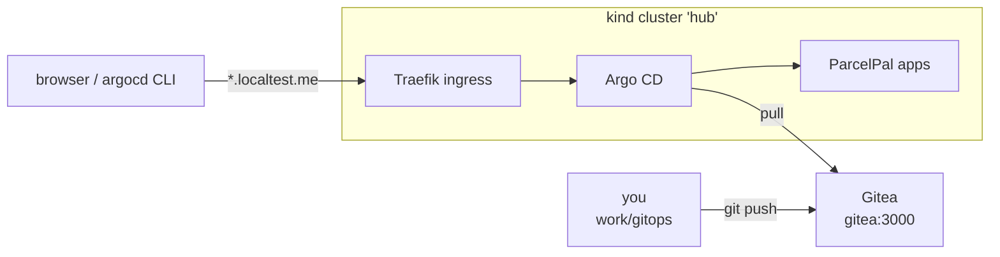

# LAB 01 – The lab environment & installing Argo CD

> **Story:** You are the new platform engineer at *ParcelPal*, a parcel-delivery startup. Today every deployment is a `kubectl apply` from somebody's laptop – nobody knows what really runs in production. Your mission: GitOps. Git becomes the single source of truth and Argo CD makes the cluster follow it.

| | |
|---|---|
| **Duration** | ~40 min |
| **Result** | a Kubernetes cluster, your own Git server and Argo CD 3.5 – reachable in the browser and the CLI |



## Step 1 – Tools

```bash
cd argocd-labs           # the folder you cloned the repository into
chmod +x bin/*
./bin/lab tools        # kind, kubectl, helm, argocd, kubeseal, kubectl-argo-rollouts (pinned versions)
```

## Step 2 – Cluster and Git server

```bash
./bin/lab up           # kind cluster "hub" + Traefik + Gitea (first run: ~3 min)
./bin/lab gitea-init   # Gitea user and the "gitops" repository, cloned to ./work/gitops
kubectl get nodes
```

✅ **Checkpoint:** one node `hub-control-plane` is `Ready`. <http://gitea:3000/student/gitops> (login `student` / `Gitea-Lab-2026!`) shows the ParcelPal repository.

> `*.localtest.me` resolves to `127.0.0.1` in public DNS, so every app gets a real host name without editing `/etc/hosts`. `gitea` is added to `/etc/hosts` by `lab up` – the same Git URL then works on the VM and inside the cluster.

## Step 3 – Install Argo CD with Helm

Look at the values file first – it is short on purpose:

```bash
cat env/argocd-values.yaml
```

| Value | Why |
|---|---|
| `global.domain` | the URL Argo CD uses in links and the ingress |
| `server.insecure: true` | Argo CD serves plain HTTP; TLS would end at the ingress (lab shortcut) |
| `timeout.reconciliation: 60s` | poll Git every minute – fast feedback in class |
| `server.ingress` | publish the UI through Traefik |

Install the chart:

```bash
helm upgrade --install argocd argo-cd --repo https://argoproj.github.io/argo-helm \
  --version 10.11.7 -n argocd --create-namespace -f env/argocd-values.yaml --wait
kubectl -n argocd get pods
```

✅ **Checkpoint:** all pods `Running`:

| Pod | Role |
|---|---|
| `argocd-server` | API, UI and CLI endpoint |
| `argocd-repo-server` | clones Git, renders Helm/Kustomize to plain manifests |
| `argocd-application-controller` | compares desired vs. live state, syncs |
| `argocd-applicationset-controller` | generates Applications (LAB08) |
| `argocd-notifications-controller` | sends notifications (LAB10) |
| `argocd-dex-server` | SSO connector |
| `argocd-redis` | cache |

> Other install options: plain manifests (`kubectl apply -f .../stable/manifests/install.yaml`), the HA manifests for production, or *core* mode (no UI/API, CLI only). Helm wins because the values file can live in Git – Argo CD can even manage itself later.

## Step 4 – The UI

```bash
argocd admin initial-password -n argocd
```

Open <http://argocd.localtest.me> and log in as `admin` with that password. Click through **Applications**, **Settings → Repositories / Clusters / Projects**, **User Info**.

## Step 5 – The CLI

```bash
argocd login argocd.localtest.me --grpc-web --insecure --username admin
argocd version
argocd cluster list
```

- `--grpc-web` – the CLI speaks gRPC; through an HTTP ingress it is wrapped in gRPC-Web.
- `--insecure` – Traefik answers HTTPS with a self-signed default certificate.

✅ **Checkpoint:** `argocd cluster list` shows `https://kubernetes.default.svc` (`in-cluster`).

## Step 6 – Secure the admin account

```bash
argocd account update-password --new-password 'ParcelPal-Admin-2026!'
kubectl -n argocd delete secret argocd-initial-admin-secret
argocd login argocd.localtest.me --grpc-web --insecure --username admin --password 'ParcelPal-Admin-2026!'
```

> In production you disable the local `admin` user (`admin.enabled: "false"`) and log in through SSO (Dex, OIDC – Entra ID, Okta, Keycloak…). LAB05 adds local users and RBAC.

## Bonus

- `kubectl get crd | grep argoproj` – which custom resources did the chart install?
- `kubectl -n argocd get cm argocd-cm -o yaml` – where did `timeout.reconciliation` end up?
- Find the Argo CD version in the UI (*User Info* / *About*) and in `argocd version` – client and server.

## Troubleshooting

| Symptom | Likely cause |
|---|---|
| `lab up`: `port 80 already in use` | another web server on the VM (`sudo ss -ltnp 'sport = :80'`) |
| UI: `404 page not found` | Argo CD not installed yet, or the ingress has another host – check `global.domain` |
| `argocd login`: `dial tcp [::1]:443: connect: connection refused` | `argocd.localtest.me` resolves to IPv6 – `lab up` adds an IPv4 entry to `/etc/hosts`; run it again |
| `argocd login`: `x509: certificate is valid for … traefik.default` | add `--insecure` (self-signed lab certificate) |
| password rejected after Step 6 | the CLI session is old – log in again with the new password |
