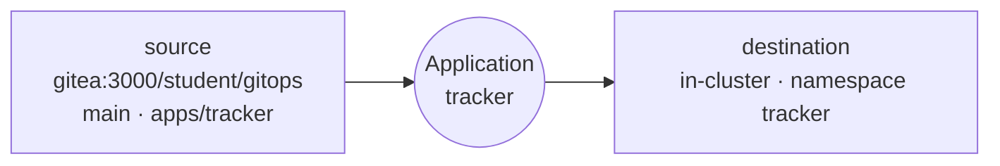

# LAB 02 – Your first application: UI, CLI and YAML

> **Story:** The parcel *tracker* is the first service to move to GitOps. Its manifests are already in Git (`apps/tracker`). You try the three ways to create an Argo CD *Application* – and keep the one that scales.

| | |
|---|---|
| **Duration** | ~40 min |
| **You create** | `work/gitops/argocd/tracker.yaml` |
| **Solution** | `solutions/LAB02/` (or `./bin/lab catchup 2`) |

An **Application** links a **source** (repo + revision + path) to a **destination** (cluster + namespace):



## Step 1 – Create it in the UI

**+ New App**:

| Field | Value |
|---|---|
| Application Name | `tracker` |
| Project | `default` |
| Sync Options | ☑ *Auto-Create Namespace* |
| Repository URL | `http://gitea:3000/student/gitops.git` |
| Revision / Path | `main` / `apps/tracker` |
| Cluster URL / Namespace | `https://kubernetes.default.svc` / `tracker` |

**Create**. The app is **OutOfSync** and **Missing** – Argo CD knows the desired state but did not apply anything yet.

Click **Sync → Synchronize**. Watch the resource tree: Deployment → ReplicaSet → Pod.

✅ **Checkpoint:** *Synced* and *Healthy*; <http://tracker.localtest.me> shows the blue ParcelPal tracker.

> Two different questions: **Sync status** – does the cluster match Git? **Health** – does it work (pods ready, ingress has an address…)? An app can be *Synced* and *Degraded* at the same time.

Delete the app: **Delete**, type the name, keep *Foreground* propagation. The `tracker` namespace is emptied – the app owned those resources.

## Step 2 – The same with the CLI

```bash
argocd app create tracker \
  --repo http://gitea:3000/student/gitops.git --revision main --path apps/tracker \
  --dest-server https://kubernetes.default.svc --dest-namespace tracker \
  --sync-option CreateNamespace=true
argocd app get tracker
argocd app sync tracker
argocd app wait tracker --health
```

Explore: `argocd app resources tracker`, `argocd app manifests tracker`, `argocd app logs tracker`.

Delete it again: `argocd app delete tracker --yes`.

## Step 3 – Declaratively, from Git (the GitOps way)

UI clicks and CLI flags are not reviewed, versioned or reproducible. An Application is just a Kubernetes resource – put it in Git:

```bash
cd work/gitops
mkdir -p argocd
cat > argocd/tracker.yaml <<'EOF'
apiVersion: argoproj.io/v1alpha1
kind: Application
metadata:
  name: tracker
  namespace: argocd
  finalizers:
    - resources-finalizer.argocd.argoproj.io     # deleting the app also deletes its resources
spec:
  project: default
  source:
    repoURL: http://gitea:3000/student/gitops.git
    targetRevision: main
    path: apps/tracker
  destination:
    server: https://kubernetes.default.svc
    namespace: tracker
  syncPolicy:
    syncOptions:
      - CreateNamespace=true
EOF
git add argocd/tracker.yaml && git commit -m "tracker as an Argo CD Application" && git push
kubectl apply -f argocd/tracker.yaml
argocd app sync tracker
```

> Applications always live in the `argocd` namespace (unless you enable *apps in any namespace*). The `finalizers` entry decides what *delete* means: with it, resources are removed; without it, they are orphaned and keep running.

## Step 4 – Change, diff, history, rollback

1. Change the message in Git:

   ```bash
   sed -i 's/ParcelPal parcel tracker"/ParcelPal parcel tracker v2"/' apps/tracker/deployment.yaml
   git commit -am "tracker v2 message" && git push
   ```

2. **Refresh** in the UI (or `argocd app get tracker --refresh`) – the app turns **OutOfSync**. Look at **App Diff** or:

   ```bash
   argocd app diff tracker
   ```

3. Sync, then look at the history and roll back to the first revision:

   ```bash
   argocd app sync tracker
   argocd app history tracker
   argocd app rollback tracker 1      # use the ID of the first entry
   ```

✅ **Checkpoint:** the page shows the old message again, and the app is **OutOfSync** – the cluster now differs from Git.

> Rollback is an emergency brake, not a workflow: Git still says "v2". The GitOps way is `git revert` + sync. (With automated sync – LAB03 – Argo CD refuses to roll back.)

Fix it the GitOps way:

```bash
git revert --no-edit HEAD && git push
argocd app sync tracker
```

✅ **Checkpoint:** *Synced*, the message is back to `ParcelPal parcel tracker`.

## Bonus

- `kubectl -n argocd get application tracker -o yaml` – find `status.sync.revision`, `status.health`, `status.history`.
- Delete with `--cascade=false` (`argocd app delete tracker --cascade=false`) and check: do the pods survive? Re-apply `argocd/tracker.yaml` afterwards – Argo CD adopts them again.

## Troubleshooting

| Symptom | Likely cause |
|---|---|
| `repository not accessible … no such host` | the repo URL must be `http://gitea:3000/...` – `localhost` is the pod itself |
| `namespaces "tracker" not found` | *Auto-Create Namespace* / `CreateNamespace=true` missing |
| app stays *OutOfSync* after a push | Argo CD polls every 60 s – press **Refresh** (LAB03 adds a webhook) |
| `rollback` refused: `auto-sync is enabled` | disable automated sync first (`argocd app set tracker --sync-policy none`) |
