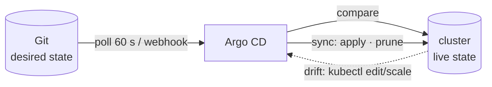

# LAB 03 – The GitOps loop: automated sync, self-heal, prune & tracking

> **Story:** On Friday evening someone "quickly" scaled the tracker by hand, and an old ConfigMap nobody needs is still lying around. From now on the cluster follows Git automatically – and only Git.

| | |
|---|---|
| **Duration** | ~45 min |
| **You edit** | `work/gitops/argocd/tracker.yaml`, `work/gitops/apps/tracker/` |
| **Solution** | `solutions/LAB03/` (or `./bin/lab catchup 3`) |



## Step 1 – Automated sync

In `argocd/tracker.yaml` replace the `syncPolicy` block:

```yaml
  syncPolicy:
    automated:
      prune: true          # delete what was removed from Git
      selfHeal: true       # undo manual changes in the cluster
    syncOptions:
      - CreateNamespace=true
```

```bash
cd work/gitops
git commit -am "tracker: automated sync" && git push
kubectl apply -f argocd/tracker.yaml
```

Now change the desired state – two replicas and a new message:

```bash
sed -i -e 's/replicas: 1/replicas: 2/' \
       -e 's/"ParcelPal parcel tracker"/"ParcelPal parcel tracker - now with GitOps"/' apps/tracker/deployment.yaml
git commit -am "tracker: 2 replicas" && git push
watch -n2 kubectl -n tracker get pods      # Ctrl+C when two pods are running
```

✅ **Checkpoint:** within one to two minutes – without clicking *Sync* – two pods run and the page shows the new message. (Argo CD polls every 60 s plus a random delay, so not all apps hit Git at the same moment.)

## Step 2 – Instant sync with a webhook

Waiting for the poll is slow. Gitea can tell Argo CD about every push.

Gitea → **gitops → Settings → Webhooks → Add Webhook → Gitea**:

| Field | Value |
|---|---|
| Target URL | `http://hub-control-plane:30080/api/webhook` |
| HTTP method / content type | `POST` / `application/json` |
| Trigger on | *Push events* |

> `hub-control-plane` is the kind node – Gitea runs in the same Docker network. The ingress forwards `/api/webhook` to `argocd-server` for any host name (see `extraRules` in `env/argocd-values.yaml`).

Push any change (e.g. the colour `#2e6db4` → `#c0392b`) and click **Test Delivery** / watch **Recent Deliveries** in Gitea.

✅ **Checkpoint:** the app syncs within seconds of `git push`.

> In production: set a webhook secret (`webhook.github.secret` etc. in `argocd-secret`) so only your Git server can trigger refreshes.

## Step 3 – Self-heal

Play the Friday-evening colleague:

```bash
kubectl -n tracker scale deploy tracker --replicas=5
kubectl -n tracker get pods -w           # Ctrl+C after a few seconds
```

✅ **Checkpoint:** Argo CD scales the deployment back to **2** almost immediately. **History and Rollback** shows nothing new – self-heal re-applies the existing revision.

Try `kubectl -n tracker set env deploy/tracker PODINFO_UI_MESSAGE=hacked` – same result.

## Step 4 – Prune

Add something to Git, then remove it again:

```bash
kubectl -n tracker create configmap tracker-legacy --from-literal=mode=legacy --dry-run=client -o yaml \
  > apps/tracker/configmap-legacy.yaml
git add -A && git commit -m "legacy config" && git push
kubectl -n tracker get cm tracker-legacy        # exists

git rm apps/tracker/configmap-legacy.yaml && git commit -m "remove legacy config" && git push
sleep 10; kubectl -n tracker get cm tracker-legacy
```

✅ **Checkpoint:** `NotFound` – removed from Git means removed from the cluster.

> Without `prune: true` Argo CD only marks such resources as *requires pruning* and leaves them. Protect single resources with the annotation `argocd.argoproj.io/sync-options: Prune=false`.

## Step 5 – Tracking strategies

`targetRevision` decides *which* commit is the desired state:

| `targetRevision` | Follows | Typical use |
|---|---|---|
| `main` / `HEAD` | the newest commit of a branch | dev, staging |
| `v1.0.0` (tag) | a fixed, named release | production |
| `3f9a1c2…` (commit SHA) | exactly one commit, immutable | audits, hot fixes |

1. Tag the current state and pin the app to it:

   ```bash
   git tag v1.0.0 && git push origin v1.0.0
   sed -i 's/targetRevision: main/targetRevision: v1.0.0/' argocd/tracker.yaml
   kubectl apply -f argocd/tracker.yaml
   ```

2. Push a change to `main` (e.g. `replicas: 3`). Wait a minute.

✅ **Checkpoint:** nothing happens – the app tracks the tag, not the branch. `argocd app get tracker` shows `Target: v1.0.0`.

3. Back to the branch for the rest of the course:

   ```bash
   sed -i 's/replicas: 3/replicas: 2/' apps/tracker/deployment.yaml
   sed -i 's/targetRevision: v1.0.0/targetRevision: main/' argocd/tracker.yaml
   git commit -am "tracker follows main again" && git push
   kubectl apply -f argocd/tracker.yaml
   ```

> Tags can be moved (`git tag -f`) – for strict immutability pin a SHA. For Helm charts `targetRevision` is a chart version or a range like `6.*`.

## Bonus

- `argocd app set tracker --sync-policy none` – and back. Why should the *Application* itself be in Git rather than changed by CLI?
- Settings → **Projects → default → Sync Windows**: add a *deny* window for the next hour and push a change. What happens to automated sync?
- Set `selfHeal: false` and scale by hand: the app is *OutOfSync* but nothing is reverted until the next Git change.

## Troubleshooting

| Symptom | Likely cause |
|---|---|
| no automatic sync | `kubectl apply -f argocd/tracker.yaml` forgotten – the file in Git is not applied by itself (until LAB08) |
| webhook delivery `404` | URL must end with `/api/webhook`; Argo CD installed with the lab values (extra ingress rule)? |
| webhook delivery `connection refused` | use `hub-control-plane:30080`, not `localhost` (Gitea's own container) |
| pinned tag still updates | the app was not re-applied, or the tag was moved |
