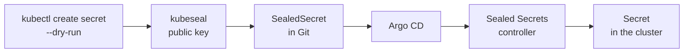

# LAB 06 – Private repositories & secrets in Git

> **Story:** The auditor found out that ParcelPal's deployment repository is public. It becomes private today – and the tracker needs an API token that must never appear in Git as plain text.

| | |
|---|---|
| **Duration** | ~45 min |
| **You create** | repository credentials (not in Git!), `argocd/sealed-secrets.yaml`, `apps/tracker/sealedsecret.yaml` |
| **Solution** | `solutions/LAB06/` (or `./bin/lab catchup 6`) |

## Part A – Make the repository private

Gitea → **gitops → Settings → Repository → Visibility: ☑ Make repository private** → *Update Settings*.

```bash
argocd app get tracker --hard-refresh | grep -iE 'condition|message|authentication' | head -3
```

✅ **Checkpoint:** *ComparisonError … authentication required*. The running apps keep running – Argo CD just cannot read the desired state any more.

## Part B – Credentials for Argo CD

Two ways to connect a repository:

| Secret label | Matches | Use |
|---|---|---|
| `argocd.argoproj.io/secret-type: repository` | exactly one repo URL | one-off repositories |
| `argocd.argoproj.io/secret-type: repo-creds` | every repo whose URL **starts with** `url` | one credential for an org / project |

ParcelPal has more repositories coming, so use a credential template. This secret contains a password – it is applied from your shell and **not** committed:

```bash
kubectl apply -f - <<'EOF'
apiVersion: v1
kind: Secret
metadata:
  name: gitea-student
  namespace: argocd
  labels:
    argocd.argoproj.io/secret-type: repo-creds
stringData:
  type: git
  url: http://gitea:3000/student
  username: student
  password: Gitea-Lab-2026!
EOF
argocd repocreds list
argocd app get tracker --hard-refresh | grep -E 'Sync Status|Health Status'
```

✅ **Checkpoint:** *Synced / Healthy* again. **Settings → Repositories** shows the template; the gitops repo connects *Successful*.

> Real setups use a read-only token, not the user's password: a Gitea/GitHub access token, a GitHub App, or a deploy key. HTTPS + token is the most common choice.

### SSH instead of HTTPS (optional, 10 min)

```bash
ssh-keygen -t ed25519 -N '' -f ~/.ssh/argocd-gitea -C argocd
cat ~/.ssh/argocd-gitea.pub      # Gitea → gitops → Settings → Deploy Keys → Add (read-only)
# trust Gitea's host key: Argo CD reaches it as "gitea" on port 22
ssh-keyscan -p 2222 127.0.0.1 2>/dev/null | sed 's/^\[127.0.0.1\]:2222/gitea/' | argocd cert add-ssh --batch
argocd repo add ssh://git@gitea/student/gitops.git --ssh-private-key-path ~/.ssh/argocd-gitea --name gitops-ssh
argocd repo list
```

> Since Argo CD 3.5 SSH host keys are always checked against `argocd-ssh-known-hosts-cm` (**Settings → Certificates**) – an unknown host is refused, never silently trusted.

## Part C – Sealed Secrets

A Kubernetes `Secret` in Git is only base64 – anybody who can read the repo can read the secret. **Sealed Secrets** encrypts it with a key that only the controller in the cluster has.



1. Install the controller – with Argo CD, of course:

   ```bash
   cd work/gitops
   cat > argocd/sealed-secrets.yaml <<'EOF'
   apiVersion: argoproj.io/v1alpha1
   kind: Application
   metadata:
     name: sealed-secrets
     namespace: argocd
   spec:
     project: default
     source:
       repoURL: https://bitnami.github.io/sealed-secrets
       chart: sealed-secrets
       targetRevision: 2.22.0
       helm:
         valuesObject:
           fullnameOverride: sealed-secrets-controller   # the name kubeseal looks for by default
     destination:
       server: https://kubernetes.default.svc
       namespace: kube-system
     syncPolicy:
       automated:
         prune: true
         selfHeal: true
   EOF
   git add argocd/sealed-secrets.yaml && git commit -m "Sealed Secrets controller" && git push
   kubectl apply -f argocd/sealed-secrets.yaml
   argocd app wait sealed-secrets --health
   ```

2. Seal the token:

   ```bash
   kubectl -n tracker create secret generic tracker-api \
     --from-literal=API_TOKEN=pp-7f3c-tracker-2026 --dry-run=client -o yaml \
     | kubeseal --controller-namespace kube-system -o yaml > apps/tracker/sealedsecret.yaml
   cat apps/tracker/sealedsecret.yaml          # encrypted, safe to commit
   ```

3. Let the tracker read it – in `apps/tracker/deployment.yaml` add `envFrom` above `env`:

   ```yaml
             envFrom:
               - secretRef:
                   name: tracker-api          # created by the Sealed Secrets controller
             env:
   ```

4. Commit and push both files:

   ```bash
   git add apps/tracker && git commit -m "Tracker API token as a SealedSecret" && git push
   ```

✅ **Checkpoint:** the tracker app shows a **SealedSecret** with a **Secret** below it; `curl -s http://tracker.localtest.me/env | grep API_TOKEN` prints the token from inside the pod.

> A SealedSecret is bound to its name and namespace – copy it to another namespace and the controller refuses to decrypt it. Back up the controller's key (`kubectl -n kube-system get secret -l sealedsecrets.bitnami.com/sealed-secrets-key -o yaml`) – without it the sealed values in Git are lost.

## Alternatives (discussion)

| Approach | Secret lives in | Good for |
|---|---|---|
| Sealed Secrets | Git (encrypted) | small teams, no external vault |
| External Secrets Operator | Azure Key Vault, AWS SM, Vault… – Git holds only a *reference* | enterprises with a secret store |
| SOPS (+ KSOPS / helm-secrets plugin) | Git (encrypted with KMS/age) | Helm/Kustomize-heavy repos |
| Argo CD Vault Plugin | placeholders replaced at render time | legacy – secrets end up in the repo-server cache |

## Troubleshooting

| Symptom | Likely cause |
|---|---|
| still *authentication required* | template `url` must be a prefix of the repo URL (`http://gitea:3000/student`), and the label `repo-creds` is spelled exactly |
| `kubeseal: cannot fetch certificate` | controller not ready, or other name – `--controller-name sealed-secrets-controller --controller-namespace kube-system` |
| pod `CreateContainerConfigError` | the Secret does not exist yet – SealedSecret not committed, or sealed for another namespace |
| `argocd repo add` (SSH): `knownhosts: key is unknown` | Step "trust Gitea's host key" skipped |
