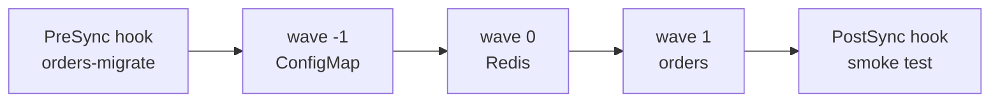

# LAB 07 – Sync waves, hooks, sync options & diff customization

> **Story:** The *orders* service needs Redis before it starts, a schema migration before every release and a smoke test after it. And the on-call team scales it by hand during peaks – Argo CD must not fight them.

| | |
|---|---|
| **Duration** | ~45 min |
| **You edit** | `work/gitops/apps/orders/`, `work/gitops/argocd/orders.yaml` |
| **Solution** | `solutions/LAB07/` (or `./bin/lab catchup 7`) |



Within one sync Argo CD applies resources **phase by phase** (PreSync → Sync → PostSync) and inside a phase **wave by wave** (lowest first). It waits until a wave is *healthy* before the next one starts.

## Step 1 – Waves

Annotate the three parts of `apps/orders` (in the `metadata` of each object):

| File / object | Annotation |
|---|---|
| `configmap.yaml` – ConfigMap `orders-config` | `argocd.argoproj.io/sync-wave: "-1"` |
| `redis.yaml` – Deployment `redis` | `argocd.argoproj.io/sync-wave: "0"` |
| `deployment.yaml` – Deployment `orders` | `argocd.argoproj.io/sync-wave: "1"` |

```yaml
metadata:
  name: redis
  annotations:
    argocd.argoproj.io/sync-wave: "0"
```

(Services and the Ingress may stay in the default wave 0.)

## Step 2 – Hooks

`apps/orders/migrate-job.yaml` – runs **before** every sync:

```yaml
apiVersion: batch/v1
kind: Job
metadata:
  name: orders-migrate
  annotations:
    argocd.argoproj.io/hook: PreSync
    argocd.argoproj.io/hook-delete-policy: BeforeHookCreation
spec:
  backoffLimit: 0
  template:
    spec:
      restartPolicy: Never
      containers:
        - name: migrate
          image: busybox:1.37
          command: ["sh", "-c", "echo 'migrating orders schema to v2'; sleep 5; echo done"]
```

`apps/orders/smoke-test.yaml` – runs **after** the app is healthy; if it fails, the sync fails:

```yaml
apiVersion: batch/v1
kind: Job
metadata:
  name: orders-smoke-test
  annotations:
    argocd.argoproj.io/hook: PostSync
    argocd.argoproj.io/hook-delete-policy: BeforeHookCreation
spec:
  backoffLimit: 0
  template:
    spec:
      restartPolicy: Never
      containers:
        - name: smoke
          image: curlimages/curl:8.11.1
          command: ["sh", "-c", "curl -fsS http://orders/healthz && curl -fsS -X POST -d 'parcel-42' http://orders/cache/smoke && curl -fsS http://orders/cache/smoke"]
```

| Hook | When |
|---|---|
| `PreSync` | before anything is applied (migrations, backups) |
| `Sync` | together with the wave 0 resources |
| `PostSync` | after all resources are healthy (tests, notifications) |
| `SyncFail` | when the sync failed (cleanup, alerting) |
| `PreDelete` / `PostDelete` | around deleting the application |

Delete policies: `BeforeHookCreation` (keep the last run for debugging – recommended), `HookSucceeded`, `HookFailed`.

## Step 3 – The application

```bash
cd work/gitops
cat > argocd/orders.yaml <<'EOF'
apiVersion: argoproj.io/v1alpha1
kind: Application
metadata:
  name: orders
  namespace: argocd
spec:
  project: parcelpal
  source:
    repoURL: http://gitea:3000/student/gitops.git
    targetRevision: main
    path: apps/orders
  destination:
    server: https://kubernetes.default.svc
    namespace: orders
  syncPolicy:
    automated:
      prune: true
      selfHeal: true
    syncOptions:
      - CreateNamespace=true
      - ServerSideApply=true
EOF
git add -A && git commit -m "orders: waves and hooks" && git push
kubectl apply -f argocd/orders.yaml
```

Watch the sync in the UI (**Sync Status → last operation**) or:

```bash
argocd app get orders --show-operation
kubectl -n orders logs job/orders-migrate
kubectl -n orders logs job/orders-smoke-test
```

✅ **Checkpoint:** the operation lists the PreSync job, then waves −1, 0, 1, then the PostSync job – all *Succeeded*. <http://orders.localtest.me> works; the smoke test log ends with `parcel-42` (read back from Redis).

**Break it:** change the smoke test URL to `http://orders/does-not-exist`, push. The sync turns **Failed** although the pods are fine – the hook protects the release. Revert.

## Step 4 – Sync options

Useful options – on the Application (`syncOptions`) or per resource (annotation `argocd.argoproj.io/sync-options`):

| Option | Effect |
|---|---|
| `CreateNamespace=true` | create the destination namespace |
| `ServerSideApply=true` | apply with server-side apply – large CRDs, field ownership |
| `PruneLast=true` | prune after all other resources are synced |
| `Prune=false` (resource) | never delete this resource |
| `Replace=true` | `kubectl replace` instead of apply – immutable fields |
| `Validate=false` | skip schema validation |
| `ApplyOutOfSyncOnly=true` | only touch changed resources – big apps |

## Step 5 – Diff customization

The on-call team scales orders during a peak:

```bash
kubectl -n orders scale deploy orders --replicas=3
```

With `selfHeal` Argo CD reverts it to 1 within seconds. The replica count should belong to people (or an autoscaler), not to Git. Tell Argo CD to ignore that field – add to `spec` of `argocd/orders.yaml`:

```yaml
  ignoreDifferences:
    - group: apps
      kind: Deployment
      name: orders
      jsonPointers:
        - /spec/replicas
```

…and to `syncOptions`:

```yaml
      - RespectIgnoreDifferences=true      # also keep the live value when syncing
```

```bash
git commit -am "orders: replicas are managed outside Git" && git push
kubectl apply -f argocd/orders.yaml
kubectl -n orders scale deploy orders --replicas=3
sleep 20; kubectl -n orders get deploy orders
```

✅ **Checkpoint:** 3 replicas stay, the app is *Synced*. Without `RespectIgnoreDifferences` the next sync would still reset replicas to the Git value.

> Ignore rules can also be global (`resource.customizations.ignoreDifferences.all` in `argocd-cm`) – e.g. fields injected by a mutating webhook. `jqPathExpressions` and `managedFieldsManagers` are alternatives to JSON pointers.

## Bonus

- Add `argocd.argoproj.io/sync-options: Prune=false` to the ConfigMap, delete `configmap.yaml` from Git and look at the app.
- A `SyncFail` hook that prints `rollback needed!` – trigger it with a broken smoke test.
- `argocd app sync orders --dry-run` and `--preview-changes`.

## Troubleshooting

| Symptom | Likely cause |
|---|---|
| sync waits forever on one wave | a resource in that wave never becomes healthy – look at its health message |
| `Job … field is immutable` | hook without delete policy – add `BeforeHookCreation` |
| app *OutOfSync* on `/spec/replicas` although ignored | group/kind/name do not match exactly; check with `argocd app diff orders` |
| smoke test `Could not resolve host: orders` | the Service is called `orders` and lives in the same namespace – typo in the URL? |
