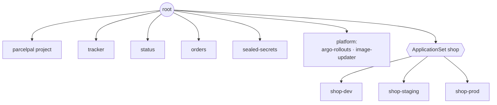

# LAB 08 – App of apps & ApplicationSet

> **Story:** ParcelPal now has eight Applications – each one applied by hand with `kubectl apply`. A new cluster would mean repeating all of that. And marketing wants a *staging* shop by tomorrow. Time to let Git bootstrap everything.

| | |
|---|---|
| **Duration** | ~45 min |
| **You create** | `bootstrap/root.yaml`, `argocd/platform/*.yaml`, `argocd/shop.yaml`, `apps/shop/overlays/staging/` |
| **Solution** | `solutions/LAB08/` (or `./bin/lab catchup 8`) |



## Part A – App of apps

Everything in `argocd/` is an Argo CD object. One *root* Application that points at that folder makes Argo CD manage its own Applications.

```bash
cd work/gitops
mkdir -p bootstrap
cat > bootstrap/root.yaml <<'EOF'
# The only object you ever apply by hand: it makes Argo CD manage everything under argocd/
apiVersion: argoproj.io/v1alpha1
kind: Application
metadata:
  name: root
  namespace: argocd
spec:
  project: default
  source:
    repoURL: http://gitea:3000/student/gitops.git
    targetRevision: main
    path: argocd
    directory:
      recurse: true
  destination:
    server: https://kubernetes.default.svc
    namespace: argocd
  syncPolicy:
    automated:
      prune: true
      selfHeal: true
EOF
git add bootstrap && git commit -m "root app" && git push
kubectl apply -f bootstrap/root.yaml
```

✅ **Checkpoint:** the *root* app is *Synced* and its tree shows the other Applications and the project as children. From now on **`git push` is enough** – no more `kubectl apply -f argocd/…`.

> `root.yaml` is outside `argocd/` on purpose: an app that manages itself is possible but makes deleting it tricky. Disaster recovery for the whole platform is now: install Argo CD, apply `bootstrap/root.yaml`.

## Part B – Platform components

Add two cluster add-ons you need later:

```bash
mkdir -p argocd/platform
cat > argocd/platform/argo-rollouts.yaml <<'EOF'
apiVersion: argoproj.io/v1alpha1
kind: Application
metadata:
  name: argo-rollouts
  namespace: argocd
spec:
  project: default
  source:
    repoURL: https://argoproj.github.io/argo-helm
    chart: argo-rollouts
    targetRevision: 2.43.8
  destination:
    server: https://kubernetes.default.svc
    namespace: argo-rollouts
  syncPolicy:
    automated:
      prune: true
      selfHeal: true
    syncOptions:
      - CreateNamespace=true
      - ServerSideApply=true          # large CRDs
EOF
sed -e 's/name: argo-rollouts$/name: argocd-image-updater/' -e 's/chart: argo-rollouts/chart: argocd-image-updater/' \
    -e 's/targetRevision: 2.43.8/targetRevision: 1.4.0/' -e 's/namespace: argo-rollouts/namespace: argocd/' \
    -e '/CreateNamespace/d' argocd/platform/argo-rollouts.yaml > argocd/platform/image-updater.yaml
git add argocd/platform && git commit -m "platform: rollouts + image updater" && git push
```

✅ **Checkpoint:** two new apps appear by themselves; `kubectl get crd | grep -E 'rollouts|imageupdaters'` lists the new CRDs.

## Part C – ApplicationSet: one template, many apps

`shop-dev.yaml` and `shop-prod.yaml` differ in two words. An **ApplicationSet** generates them from a template – here one Application per folder in `apps/shop/overlays/`:

```bash
cat > argocd/shop.yaml <<'EOF'
apiVersion: argoproj.io/v1alpha1
kind: ApplicationSet
metadata:
  name: shop
  namespace: argocd
spec:
  goTemplate: true
  goTemplateOptions: ["missingkey=error"]
  generators:
    - git:
        repoURL: http://gitea:3000/student/gitops.git
        revision: main
        directories:
          - path: apps/shop/overlays/*
  template:
    metadata:
      name: 'shop-{{.path.basename}}'
      labels:
        parcelpal/env: '{{.path.basename}}'
    spec:
      project: parcelpal
      source:
        repoURL: http://gitea:3000/student/gitops.git
        targetRevision: main
        path: '{{.path.path}}'
      destination:
        server: https://kubernetes.default.svc
        namespace: 'shop-{{.path.basename}}'
      syncPolicy:
        automated:
          prune: true
          selfHeal: true
        syncOptions:
          - CreateNamespace=true
EOF
git rm -q argocd/shop-dev.yaml argocd/shop-prod.yaml
git add argocd/shop.yaml && git commit -m "shop: ApplicationSet" && git push
```

The root app prunes the two hand-written Applications (they have no finalizer, so the shop keeps running) and the ApplicationSet generates new ones with the same names.

✅ **Checkpoint:** `argocd appset get shop` lists `shop-dev` and `shop-prod`; both shops still answer.

**The payoff – a new environment is a folder:**

```bash
mkdir -p apps/shop/overlays/staging
sed -e 's/env: dev/env: staging/' -e 's/shop-dev.localtest.me/shop-staging.localtest.me/' \
    -e 's/shop - dev/shop - staging/' -e 's/#d2691e/#9370db/' -e '/^images:/,$d' \
    apps/shop/overlays/dev/kustomization.yaml > apps/shop/overlays/staging/kustomization.yaml
git add apps/shop/overlays/staging && git commit -m "shop: staging" && git push
```

✅ **Checkpoint:** a purple <http://shop-staging.localtest.me> appears – nobody wrote an Application for it.

## Generators

| Generator | One app per… | Example |
|---|---|---|
| `list` | element of a static list | three regions with parameters |
| `git` directories / files | folder or JSON/YAML file in a repo | environments, tenants |
| `clusters` | cluster registered in Argo CD (label selector) | add-ons on every cluster (LAB09) |
| `matrix` / `merge` | combination of two generators | every env × every cluster |
| `scmProvider` / `pullRequest` | repository in an org / open pull request | preview environments per PR |
| `plugin` | answer of your own HTTP service | anything else |

> ApplicationSet `syncPolicy.preserveResourcesOnDeletion: true` keeps workloads running when the ApplicationSet itself is deleted. *Progressive syncs* (`strategy: RollingSync`) roll a change through dev → staging → prod step by step.

## Bonus

- Delete `apps/shop/overlays/staging` from Git. What happens to the app and to the namespace?
- Rewrite the ApplicationSet with a `list` generator (`env: dev, color: …`) – which approach scales better?
- Edit `shop-dev` in the UI (e.g. disable auto-sync). Who wins, you or the ApplicationSet?

## Troubleshooting

| Symptom | Likely cause |
|---|---|
| root app *OutOfSync* forever on an Application | defaults added by the controller – usually harmless; check `argocd app diff root` |
| ApplicationSet `ErrorOccurred`: `application already exists` | an Application with the same name exists and is not managed by the set – delete it (without cascade) or let the root prune it |
| `missingkey=error` / `map has no entry for key` | template variable typo – with `goTemplate` it is `{{.path.basename}}`, not `{{path.basename}}` |
| staging app not generated | folder not pushed, or the generator path does not match (`apps/shop/overlays/*`) |
