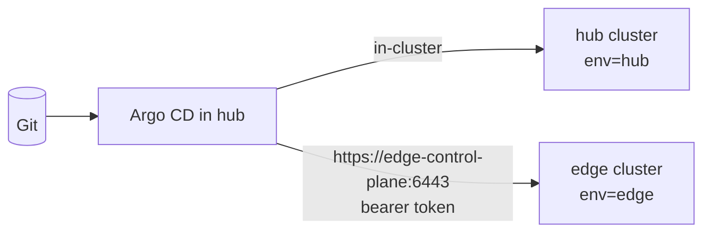

# LAB 09 – Multi-cluster: one Argo CD, many clusters

> **Story:** ParcelPal opens its first regional depot with its own small cluster (*edge*). The depot app must run there and in the main cluster, and every future depot should get it automatically.

| | |
|---|---|
| **Duration** | ~35 min |
| **You create** | the `edge` cluster, `argocd/clusters/in-cluster.yaml`, `argocd/fleet.yaml` |
| **Solution** | `solutions/LAB09/` (or `./bin/lab catchup 9`) |



**Hub-and-spoke** (this lab): one Argo CD manages many clusters – one UI, one place for RBAC, but the hub holds credentials for every cluster. **Instance per cluster**: each cluster runs its own Argo CD – isolated, no central view. Many companies mix both.

## Step 1 – A second cluster

```bash
./bin/lab edge
kubectl config get-contexts           # kind-hub, kind-edge
```

## Step 2 – Register it in Argo CD

```bash
argocd cluster add kind-edge --name edge --label env=edge --cluster-endpoint kube-public --yes
argocd cluster list
```

What happened:

1. The CLI used your kubeconfig to create a ServiceAccount `argocd-manager` (cluster-admin) in *edge*.
2. It stored the API address and the SA token as a **cluster Secret** in the `argocd` namespace of *hub*.

`--cluster-endpoint kube-public` takes the API address the cluster publishes about itself (`https://edge-control-plane:6443`) – reachable from inside *hub*. Your kubeconfig points to `127.0.0.1:<port>`, which would be the Argo CD pod itself.

```bash
kubectl -n argocd get secrets -l argocd.argoproj.io/secret-type=cluster
```

✅ **Checkpoint:** `argocd cluster list` shows `edge` with status *Successful* (it turns *Successful* once an app is deployed there; *Unknown* until then is normal).

> In production give Argo CD less than cluster-admin (`--namespace` scoped or a custom ClusterRole), and prefer short-lived credentials: workload identity for AKS/EKS/GKE, `execProviderConfig`, or the Argo CD *agent*.

## Step 3 – Label the hub cluster too

The local cluster has no Secret by default, so it has no labels. Give it one, declaratively:

```bash
cd work/gitops
mkdir -p argocd/clusters
cat > argocd/clusters/in-cluster.yaml <<'EOF'
# Gives the local cluster ("in-cluster") a label, so cluster generators can select it.
# No credentials inside - Argo CD uses its own service account for in-cluster.
apiVersion: v1
kind: Secret
metadata:
  name: cluster-in-cluster
  namespace: argocd
  labels:
    argocd.argoproj.io/secret-type: cluster
    env: hub
stringData:
  name: in-cluster
  server: https://kubernetes.default.svc
  config: '{"tlsClientConfig":{"insecure":false}}'
EOF
```

## Step 4 – Allow the new destination

Add to `destinations` in `argocd/project-parcelpal.yaml`:

```yaml
    - server: https://kubernetes.default.svc
      namespace: fleet
    - name: edge                                 # the second cluster
      namespace: fleet
```

## Step 5 – One ApplicationSet for the fleet

```bash
cat > argocd/fleet.yaml <<'EOF'
# One Application per cluster labelled env=hub or env=edge
apiVersion: argoproj.io/v1alpha1
kind: ApplicationSet
metadata:
  name: fleet
  namespace: argocd
spec:
  goTemplate: true
  goTemplateOptions: ["missingkey=error"]
  generators:
    - clusters:
        selector:
          matchExpressions:
            - key: env
              operator: In
              values: [hub, edge]
  template:
    metadata:
      name: 'fleet-{{.name}}'
    spec:
      project: parcelpal
      source:
        repoURL: https://stefanprodan.github.io/podinfo
        chart: podinfo
        targetRevision: 6.17.0
        helm:
          releaseName: depot
          valuesObject:
            ui:
              message: 'ParcelPal depot app on cluster {{.name}}'
      destination:
        server: '{{.server}}'
        namespace: fleet
      syncPolicy:
        automated:
          prune: true
          selfHeal: true
        syncOptions:
          - CreateNamespace=true
EOF
git add -A && git commit -m "fleet: depot app on every cluster" && git push
```

✅ **Checkpoint:** two apps `fleet-in-cluster` and `fleet-edge`, both *Healthy*:

```bash
kubectl --context kind-edge -n fleet get pods
kubectl --context kind-edge -n fleet port-forward svc/depot-podinfo 9898:9898 &
curl -s localhost:9898 | grep message; kill %1
```

The message names the cluster – the template filled in `{{.name}}` per cluster.

**The payoff:** every cluster you add with `--label env=edge` gets the depot app – no new YAML.

## Bonus

- **Matrix generator:** combine `clusters` with a `list` of two apps (depot, tracker-lite) – four Applications from one ApplicationSet.
- Label `edge` additionally with `region=north` (`argocd cluster set edge --label env=edge --label region=north`) and use the label in the template (`{{index .metadata.labels "region"}}`).
- Remove the label from `edge` – what happens to `fleet-edge`?

## Troubleshooting

| Symptom | Likely cause |
|---|---|
| `fleet-edge`: `dial tcp 127.0.0.1:…: connection refused` | the cluster was added without `--cluster-endpoint kube-public` – remove (`argocd cluster rm edge`) and add again |
| `fleet-in-cluster` missing | the `in-cluster` Secret has no `env: hub` label, or root has not synced yet |
| `application destination … is not permitted in project` | Step 4 forgotten |
| apps generated but `Unknown` | look at the cluster: `argocd cluster get edge` – connection state and message |
