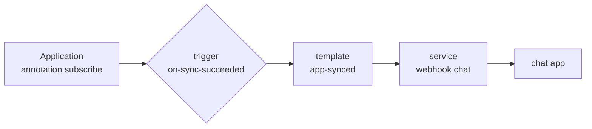
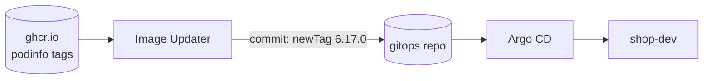

# LAB 10 – Notifications & Image Updater

> **Story:** Developers want to know when their app reached production without staring at the Argo CD UI. And the dev shop should always run the newest podinfo release – with every update visible as a commit in Git.

| | |
|---|---|
| **Duration** | ~45 min |
| **You edit** | `env/argocd-values.yaml`, `argocd/tracker.yaml`; you create `argocd/chat.yaml`, `argocd/image-updater/shop-dev.yaml` |
| **Solution** | `solutions/LAB10/` (or `./bin/lab catchup 10`) |

## Part A – Notifications

The notifications controller watches Applications and sends messages through **services** (Slack, Teams, e-mail, webhook, GitHub, Opsgenie…), rendered from **templates**, when **triggers** fire, to apps that **subscribe** with an annotation.



Our "chat" is a small app that prints every request it receives – a stand-in for Slack.

1. Deploy it (root picks it up – LAB08):

   ```bash
   cd work/gitops
   cat > argocd/chat.yaml <<'EOF'
   apiVersion: argoproj.io/v1alpha1
   kind: Application
   metadata:
     name: chat
     namespace: argocd
   spec:
     project: default
     source:
       repoURL: http://gitea:3000/student/gitops.git
       targetRevision: main
       path: apps/chat
     destination:
       server: https://kubernetes.default.svc
       namespace: chat
     syncPolicy:
       automated:
         prune: true
         selfHeal: true
       syncOptions:
         - CreateNamespace=true
   EOF
   git add argocd/chat.yaml && git commit -m "chat receiver" && git push
   ```

2. Configure service, templates and triggers – append to `env/argocd-values.yaml`:

   ```yaml
   notifications:
     notifiers:
       service.webhook.chat: |
         url: http://chat.chat.svc
         headers:
           - name: Content-Type
             value: application/json
     templates:
       template.app-synced: |
         webhook:
           chat:
             method: POST
             body: |
               {"text": ":white_check_mark: {{.app.metadata.name}} synced to {{.app.status.sync.revision | trunc 7}}"}
       template.app-degraded: |
         webhook:
           chat:
             method: POST
             body: |
               {"text": ":red_circle: {{.app.metadata.name}} is {{.app.status.health.status}}"}
     triggers:
       trigger.on-sync-succeeded: |
         - when: app.status.operationState != nil and app.status.operationState.phase in ['Succeeded']
           oncePer: app.status.sync.revision
           send: [app-synced]
       trigger.on-health-degraded: |
         - when: app.status.health.status == 'Degraded'
           send: [app-degraded]
   ```

   ```bash
   ./bin/lab install-argocd
   ```

3. Subscribe the tracker – in `argocd/tracker.yaml` under `metadata`:

   ```yaml
     annotations:
       notifications.argoproj.io/subscribe.on-sync-succeeded.chat: ""
       notifications.argoproj.io/subscribe.on-health-degraded.chat: ""
   ```

4. Push, then change the tracker (e.g. its colour) and push again:

   ```bash
   git commit -am "tracker: notify chat" && git push
   sed -i 's/#2e6db4/#16a085/' apps/tracker/deployment.yaml && git commit -am "tracker: new colour" && git push
   kubectl -n chat logs deploy/chat --tail=30 | grep '"text"'
   ```

✅ **Checkpoint:** the chat log shows `:white_check_mark: tracker synced to <sha>` – once per revision.

**Degraded:** set the tracker image to `ghcr.io/stefanprodan/podinfo:9.9.9`, push – after the progress deadline the chat says `:red_circle: tracker is Degraded`. Revert.

> Real Slack: `service.slack: { token: $slack-token }` with the token in `argocd-notifications-secret`, and annotation `…subscribe.on-sync-succeeded.slack: deployments`. The [catalog](https://argo-cd.readthedocs.io/en/stable/operator-manual/notifications/catalog/) has ready-made triggers and templates.

## Part B – Argo CD Image Updater

Image Updater watches container registries and bumps image tags of Argo CD apps. With *git write-back* the bump is a commit – Git stays the source of truth.



1. Credentials for the write-back. Image Updater pushes over **SSH or HTTPS** only – our Gitea speaks plain HTTP, so it gets an SSH deploy key that may write:

   ```bash
   ssh-keygen -q -t ed25519 -N '' -C image-updater -f ~/.ssh/image-updater
   cat ~/.ssh/image-updater.pub
   ```

   Gitea → **gitops → Settings → Deploy Keys → Add Deploy Key**: title `image-updater`, paste the key, ☑ **Enable Write Access**.

   Trust Gitea's host key (skip if you did the SSH part of LAB06) and store the private key as a Secret – not in Git:

   ```bash
   ssh-keyscan -p 2222 127.0.0.1 2>/dev/null | sed 's/^\[127.0.0.1\]:2222/gitea/' | argocd cert add-ssh --batch --upsert
   kubectl -n argocd create secret generic git-creds --from-file=sshPrivateKey=$HOME/.ssh/image-updater
   kubectl -n argocd rollout restart deploy/argocd-image-updater-controller     # re-read the known hosts
   ```

2. Tell it what to watch (Image Updater 1.x is configured with an `ImageUpdater` resource):

   ```bash
   mkdir -p argocd/image-updater
   cat > argocd/image-updater/shop-dev.yaml <<'EOF'
   # Keep shop-dev on the newest podinfo 6.x - and record every bump as a commit in Git
   apiVersion: argocd-image-updater.argoproj.io/v1alpha1
   kind: ImageUpdater
   metadata:
     name: shop-dev
     namespace: argocd
   spec:
     applicationRefs:
       - namePattern: shop-dev
         images:
           - alias: shop
             imageName: ghcr.io/stefanprodan/podinfo:6.x       # semver constraint
             commonUpdateSettings:
               updateStrategy: semver
         writeBackConfig:
           method: git:secret:git-creds
           gitConfig:
             repository: ssh://git@gitea/student/gitops.git    # write-back needs SSH or HTTPS
             branch: main
             writeBackTarget: kustomization
   EOF
   git add argocd/image-updater && git commit -m "image updater for shop-dev" && git push
   ```

3. Wait (it checks every 2 minutes) and watch:

   ```bash
   kubectl -n argocd logs deploy/argocd-image-updater-controller -f | grep -i shop     # Ctrl+C
   git pull && git log --oneline -3 && tail -4 apps/shop/overlays/dev/kustomization.yaml
   curl -s http://shop-dev.localtest.me/version
   ```

✅ **Checkpoint:** a commit by *argocd-image-updater* changed `newTag` to `6.17.0` in the dev overlay; shop-dev runs 6.17.0, prod is untouched.

| Strategy | Picks |
|---|---|
| `semver` | highest version matching a constraint (`6.x`, `~6.16`) |
| `newest-build` | most recently built tag (filter with `allowTags`) |
| `digest` | newest digest of a mutable tag (`latest`, `main`) |
| `alphabetical` | last tag in sort order (calendar versions) |

> Write-back `argocd` (default) changes only the Application spec – quick, but invisible in Git. Use `git` for anything that matters; add `pullRequest` to get a PR instead of a direct push.

## Troubleshooting

| Symptom | Likely cause |
|---|---|
| no message in chat | app not subscribed (annotation typo), or the trigger condition never true – `kubectl -n argocd logs deploy/argocd-notifications-controller` |
| `notification service 'chat' is not supported` | the `service.webhook.chat` key is missing – values not applied (`./bin/lab install-argocd`) |
| Image Updater: `could not get creds … unknown repository type` | write-back URL is plain `http://` – set `gitConfig.repository` to the `ssh://` URL |
| Image Updater: `knownhosts: key is unknown` | Gitea host key not in **Settings → Certificates**, or the controller was not restarted afterwards |
| Image Updater: `could not get credentials` | Secret `git-creds` missing or in another namespace than the `ImageUpdater` |
| Image Updater: `skipping app … not of supported source type` | the app must render with Kustomize or Helm for these write-back targets |
| commit lands but shop-dev does not change | the image name in `kustomization.yaml` must match the one in the deployment |
